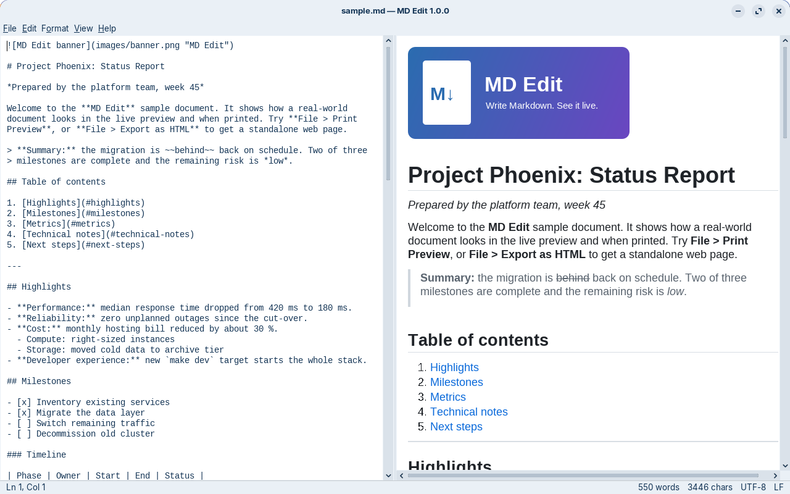

# MD Edit

A small, fast, **dependency-free Markdown editor** written in Java Swing.
Type Markdown on the left and watch a live, styled preview on the right.
It ships as a single runnable jar that works on **Linux, macOS and Windows**
with any Java 11+ runtime.




## Features

- Split view: plain-text editor on the left, live rendered preview on the right
  (debounced refresh, scroll position kept, optional scroll sync).
- Built-in Markdown parser covering the CommonMark / GitHub-flavoured
  features people use every day:
  - ATX (`#`) and Setext (`===` / `---`) headings with link anchors
  - *emphasis*, **strong**, ***both***, ~~strikethrough~~, `inline code`
    (underscores inside words such as `snake_case` are left alone)
  - fenced (```` ``` ```` / `~~~`) and indented code blocks
  - nested block quotes; nested, mixed, tight and loose lists; task lists;
    ordered lists with any start number
  - tables with column alignment, escaped pipes (`\|`) and code spans
  - inline, reference and image links, `<autolinks>`, bare URLs
  - hard line breaks, HTML entities, backslash escapes, simple inline HTML,
    HTML blocks and hidden HTML comments
- Relative images and links resolve against the document's folder; clicking a
  link to a local `.md` file opens it, web links open in your browser.
- **File** menu: New, Open, Open Recent, Close, Save, Save As, Export as HTML,
  Page Setup, Print Preview, Print, Exit.
- **Printing prints the rendered, styled document** (with page header and page
  numbers), not the raw text. Print preview has zoom and page navigation.
- Export to a standalone HTML page with clean, GitHub-like styling.
- Find / Replace, Format menu shortcuts (bold, italic, headings, lists, links,
  tables ...), undo / redo, word wrap, zoom.
- Remembers recent files, window size, divider position, font size and view
  options. Drag and drop files onto the window to open them.
- Keeps the original line endings of the file when saving; all files are read
  and written as UTF-8.
- Built-in **Help > Markdown Guide** with a cheat sheet.

## Running

You need a Java runtime, version 11 or newer.

**Download:** get `md-edit.jar` (ready to run) or the full source bundle from the
[Releases page](https://github.com/gfetters/md-edit/releases).

```
java -jar md-edit.jar               # start with an empty document
java -jar md-edit.jar notes.md      # open a file
```

On most desktops you can also simply **double-click `md-edit.jar`** (Windows
and macOS associate `.jar` files with Java when a JRE/JDK is installed; on
Linux choose "Open with Java").

Try the demo document: `java -jar dist/md-edit.jar samples/sample.md`.

**Linux command and desktop icon**

```
./install-linux.sh              # adds the md-edit command, an app-menu entry and a desktop icon
./install-linux.sh --uninstall  # removes them again
```

After installing, run `md-edit [file.md]` from any terminal, or start MD Edit from the
app menu or the desktop icon. The installer points at the project folder, so run it again
if you move the folder.

## Building

The build needs a **JDK 11 or newer** (it compiles with `--release 11`, so a
newer JDK still produces a jar that runs on Java 11). The scripts use
`$JAVA_HOME/bin/javac` when `JAVA_HOME` is set, otherwise `javac` from the
`PATH`. The result is `dist/md-edit.jar`.

**Linux / macOS**

```
./build.sh
# or with a specific JDK:
JAVA_HOME=/path/to/jdk ./build.sh
```

**Windows** (Command Prompt or PowerShell)

```
build.bat
rem or with a specific JDK:
set JAVA_HOME=C:\Program Files\Java\jdk-17
build.bat
```

`./build.sh clean` / `build.bat clean` removes `build/` and `dist/`.

**Versions and releases**

The version number lives in the `VERSION` file (`MAJOR.MINOR.PATCH`). It is shown
in the window title bar (`sample.md — MD Edit 1.0.0`) and in Help > About, and is
written into the jar manifest as `Implementation-Version`.

A plain build uses the current version. To make a release, let the build script
increment the number first. It also updates `pom.xml` to match:

```
./build.sh release          # 1.0.0 -> 1.0.1  (bug-fix release)
./build.sh release minor    # 1.0.1 -> 1.1.0  (new features)
./build.sh release major    # 1.1.0 -> 2.0.0  (big or incompatible changes)
```

On Windows use `build.bat release [patch|minor|major]` the same way.

**Maven / IDEs**

A minimal `pom.xml` is included, so the project can be imported into IntelliJ
IDEA, Eclipse, NetBeans or VS Code as a Maven project, or built with:

```
mvn package        # produces target/md-edit.jar
```

There are no third-party dependencies, so any IDE can also just compile
`src/main/java` and add `src/main/resources` to the classpath.

## Keyboard shortcuts

"Mod" means **Ctrl** on Windows and Linux and **Cmd** on macOS.

| Menu | Command | Shortcut |
|------|---------|----------|
| File | New | Mod+N |
| | Open | Mod+O |
| | Close | Mod+W |
| | Save | Mod+S |
| | Save As | Mod+Shift+S |
| | Export as HTML | Mod+Shift+E |
| | Page Setup | Mod+Shift+P |
| | Print | Mod+P |
| | Print Preview | menu only |
| | Exit | Ctrl+Q (Windows/Linux); on macOS use Quit in the app menu (Cmd+Q) |
| Edit | Undo | Mod+Z |
| | Redo | Ctrl+Y or Ctrl+Shift+Z (Windows/Linux), Cmd+Shift+Z (macOS) |
| | Cut / Copy / Paste | Mod+X / Mod+C / Mod+V |
| | Select All | Mod+A |
| | Find / Replace | Mod+F |
| | Find Next | F3 (also Cmd+G on macOS) |
| | Find Previous | Shift+F3 (also Cmd+Shift+G on macOS) |
| Format | Bold | Mod+B |
| | Italic | Mod+I |
| | Strikethrough | Mod+Shift+X |
| | Inline Code | Mod+Shift+C |
| | Link | Mod+K |
| | Image | Mod+Shift+I |
| | Heading 1 / 2 / 3 | Mod+1 / Mod+2 / Mod+3 |
| | Bullet List | Mod+Shift+8 |
| | Numbered List | Mod+Shift+7 |
| | Task List | Mod+Shift+T |
| | Blockquote | Mod+Shift+B |
| | Code Block | Mod+Shift+K |
| | Table, Horizontal Rule | menu only |
| View | Show Preview | Mod+Shift+R |
| | Zoom In | Mod+= (also Mod+Plus) |
| | Zoom Out | Mod+- |
| | Reset Zoom | Mod+0 |
| | Word Wrap, Sync Scrolling | menu only |
| Help | Markdown Guide | F1 (Windows/Linux) |

In the Find / Replace dialog, **Enter** runs Find Next and **Esc** closes it.

Other conveniences: drag a file onto the window to open it; clicking a link to
a local `.md` file in the preview opens that file. Preferences are stored with
`java.util.prefs` under the node `com/mdedit`.

## Using MD Edit as a library

Everything lives in the package `com.mdedit` and needs only the JDK. Add
`md-edit.jar` to your classpath (or copy the sources).

### Embedding the editor component

`MarkdownEditorPanel` is a plain `JPanel` containing the editor, the live
preview and the split pane, so you can drop it into any Swing application:

```java
import com.mdedit.MarkdownEditorPanel;
import javax.swing.*;

SwingUtilities.invokeLater(() -> {
    MarkdownEditorPanel editor = new MarkdownEditorPanel();
    editor.setMarkdown("# Hello\n\nEdit *me*!");
    editor.setBaseDirectory(new java.io.File("docs"));   // resolve relative images
    editor.addChangeListener(() -> System.out.println("edited"));

    JFrame f = new JFrame("My app");
    f.add(editor);
    f.setSize(1000, 700);
    f.setDefaultCloseOperation(WindowConstants.EXIT_ON_CLOSE);
    f.setVisible(true);
});
```

Useful methods: `getMarkdown()` / `setMarkdown(String)`, `setBaseDirectory(File)`,
`addChangeListener` / `removeChangeListener`, `getUndoAction()` /
`getRedoAction()` (ready to put in a menu), `setWordWrap`, `setSyncScroll`,
`setPreviewVisible`, `zoomIn()` / `zoomOut()` / `resetZoom()`,
`setOpenFileHandler(Consumer<File>)` (called when a link to a local `.md`
file is clicked), plus `getEditor()`, `getPreview()` and `getSplitPane()`
for direct access to the Swing components.

### Converting Markdown to HTML

```java
String fragment = com.mdedit.MarkdownParser.toHtml("**Hello** _world_");
// <p><strong>Hello</strong> <em>world</em></p>

String page = com.mdedit.HtmlRenderer.buildExportHtml(markdown, "My title");
// a complete, styled, standalone HTML document
```

`MarkdownParser.toHtml` never throws: any input (including malformed or
huge documents) produces HTML. `MarkdownParser.slugify(heading)` gives the
anchor name used for a heading.

### Printing and export

```java
PrintSupport ps = new PrintSupport(parentComponent);
ps.pageSetup();                                  // page format dialog
ps.printPreview(markdown, baseUrl, "notes.md");  // preview window
ps.print(markdown, baseUrl, "notes.md");         // native print dialog
PrintSupport.exportHtml(new File("notes.html"), markdown, "notes");
```

`HtmlRenderer.createPrintPane(markdown, baseUrl)` returns an off-screen,
fully laid-out `JEditorPane` if you want to do your own printing.

## Project layout

```
src/main/java/com/mdedit/      Java sources
src/main/resources/com/mdedit/ guide.md (Help > Markdown Guide)
samples/                       sample.md demo document and images
src/main/version/com/mdedit/   version.properties template (Maven only)
icons/md-edit.png              application icon
docs/screenshot.png            README screenshot
build.sh, build.bat, pom.xml   build scripts
md-edit, install-linux.sh      Linux launcher command and installer
VERSION                        current version number
```

## License

MIT. See [LICENSE](LICENSE).
